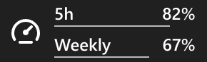

# Codex Quota

A compact Windows taskbar panel for the 5-hour and weekly Codex quotas.



## Use

Extract the Windows x64 ZIP from Releases to a permanent folder and open `CodexQuota.exe`. You need Codex installed and signed in. If a release is unavailable, build from source below.

- Click the panel for reset times, refresh, icon style, and startup options.
- Drag the icon to position the panel. It uses the primary horizontal taskbar. Windows does not reserve space for it.
- Quotas refresh at startup and about every two minutes. Dimmed values may be stale. `--` means unavailable.

Turn off **Start with Windows** in the panel menu before moving or deleting the executable.

## Build from source

Use stable Rust for `x86_64-pc-windows-msvc`, Visual Studio Build Tools with C++, and the Windows SDK.

```powershell
./build-rust.ps1 -Test
Start-Process ./dist/CodexQuota.exe
```

Run `./install.ps1 -StartWithWindows` to install per user with automatic startup. Parser tests use local fixtures. Taskbar placement needs a Windows desktop session.

## Data and support

The panel reads `account/rateLimits/read` through the local Codex app server using your existing session. It does not read credential files or log raw responses. See the [Codex app-server protocol](https://learn.chatgpt.com/docs/app-server).

When reporting a problem, include your Windows version, display scale, and taskbar setup. Keep account and quota data out of reports.

## License

[MIT](LICENSE) for the project source. The UI uses [Slint](https://slint.dev/). See the [third-party notices](assets/NOTICE.md).

[](https://slint.dev/)
